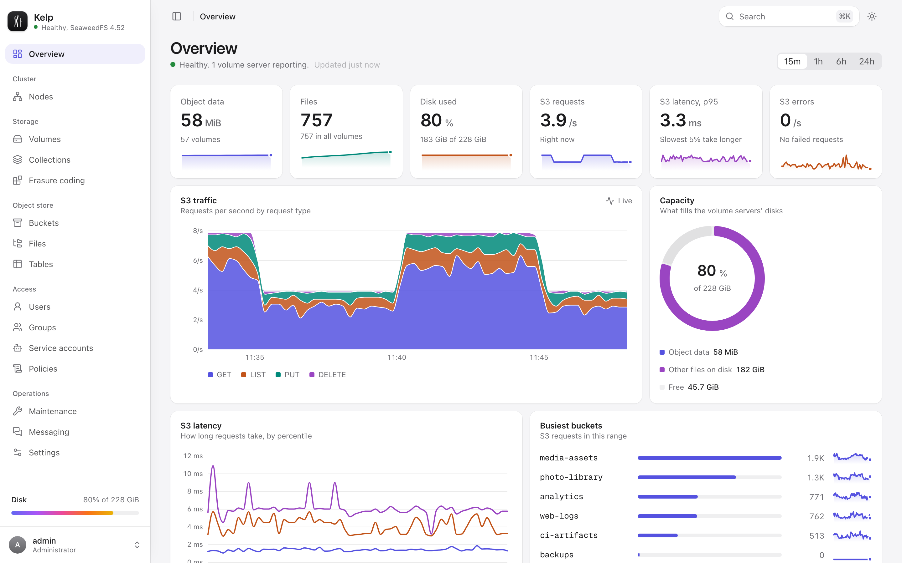
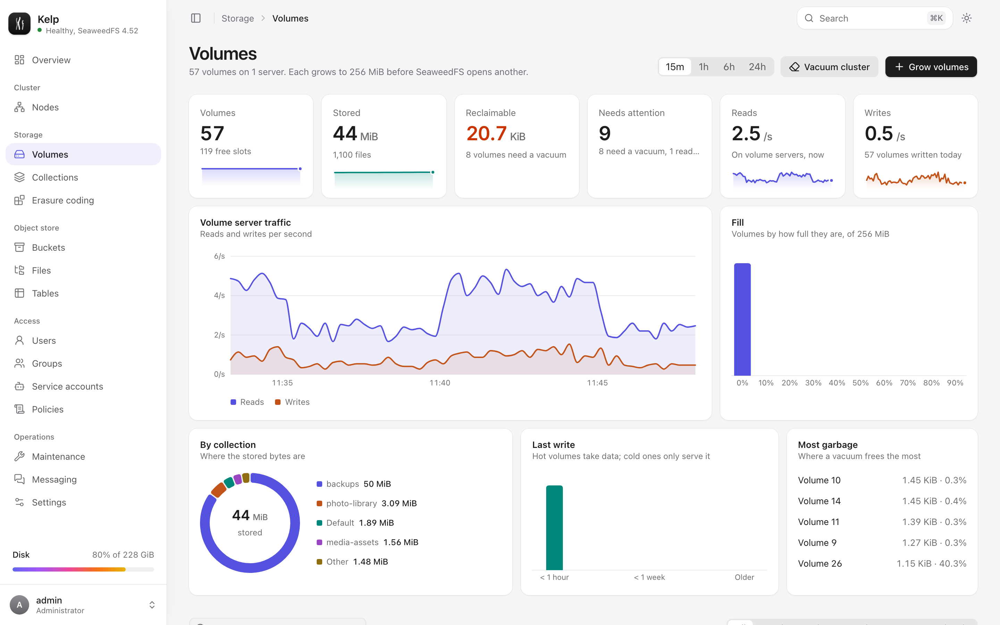
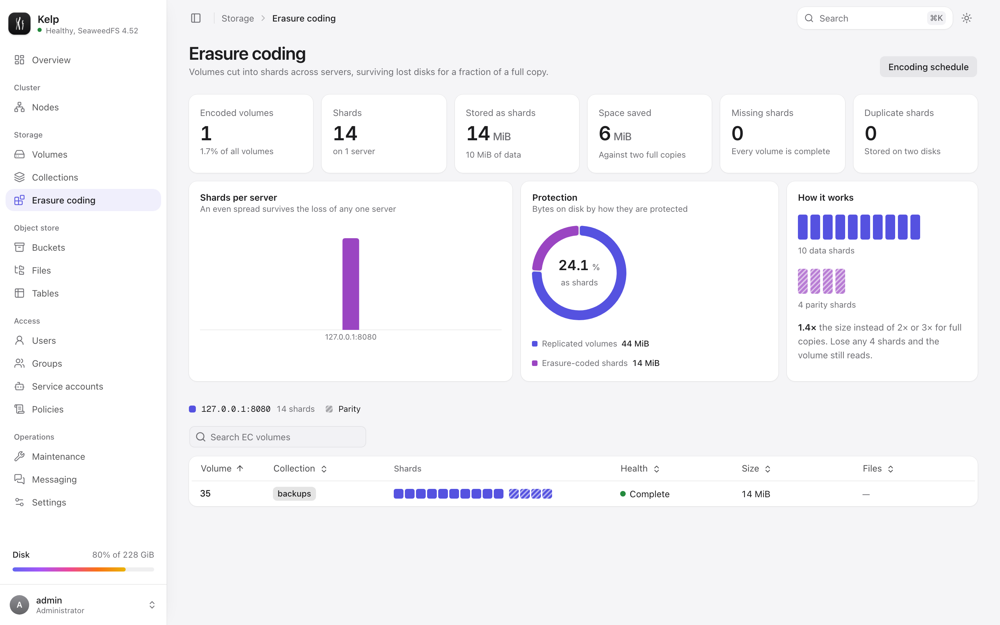
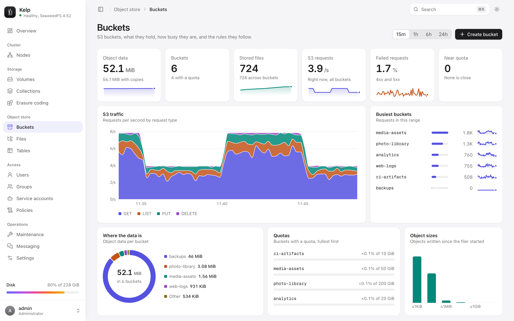
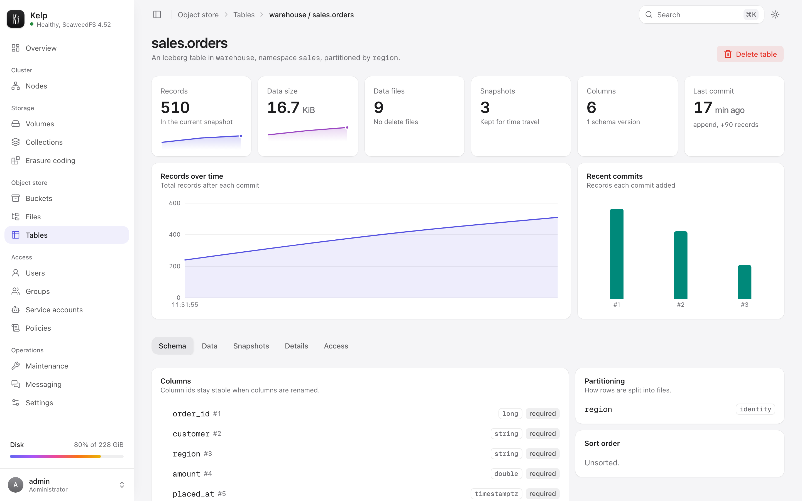
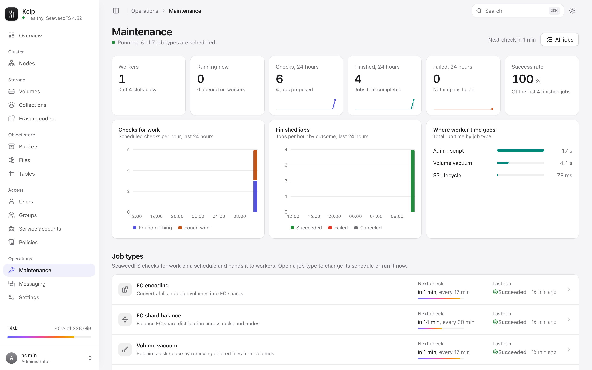
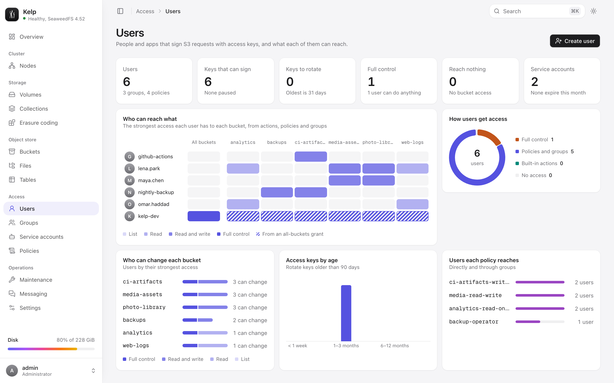

<p align="center">
  
</p>

<h1 align="center">Kelp</h1>

<p align="center">
  A calm, complete console for <a href="https://github.com/seaweedfs/seaweedfs">SeaweedFS</a>.<br>
  Shipped with SeaweedFS as one Docker Compose stack, so both deploy and upgrade together.
</p>

<p align="center">
  <a href="https://github.com/vvisionnn/kelp/actions/workflows/ci.yml"></a>
  <a href="https://github.com/vvisionnn/kelp/releases/latest"></a>
  <a href="LICENSE"></a>
</p>

<picture>
  <source media="(prefers-color-scheme: dark)" srcset="docs/screenshots/overview-dark.png">
  
</picture>

Kelp manages a SeaweedFS cluster without changing it. It drives the native admin API, the master, the filer and their gRPC services, and adds what the built-in pages lack: a calm design of its own, live charts sampled from SeaweedFS's own metrics, sign-in with read-only accounts, safer destructive actions, light and dark themes, a command menu (⌘K) and a sidebar that folds to icons (⌘B), and pages that explain what they show.

## What you can do

| Area             | In Kelp                                                                                                                                                                                                                                                                                                                             |
| ---------------- | ----------------------------------------------------------------------------------------------------------------------------------------------------------------------------------------------------------------------------------------------------------------------------------------------------------------------------------- |
| **Overview**     | Live S3 traffic by request type, latency percentiles and errors, capacity, the busiest buckets, volume server and filer activity, over the last 15 minutes to 24 hours.                                                                                                                                                             |
| **Cluster**      | Health at a glance, disk capacity, storage tiers, version drift. Topology by data center and rack. Masters (with the Raft leader), volume servers, filers, S3 gateways, message brokers and FUSE mounts.                                                                                                                            |
| **Storage**      | Every volume with size, files, garbage and replica health. Vacuum a volume or the whole cluster, freeze and unfreeze volumes, grow volumes into a collection, delete collections. An animated shard map for every erasure-coded volume, with rebuild guidance when shards go missing.                                               |
| **Object store** | Create buckets with quota, owner, versioning and object lock. Lifecycle rules, bucket policies with templates, and a file browser for the whole filer: streaming uploads with drag and drop, folders, rename, bulk delete, previews for images, video, audio, PDF, text and JSON. Version history for objects in versioned buckets. |
| **Tables**       | S3 Tables and Iceberg: table buckets, namespaces and tables, tags and policies, and a table view with schema, partitioning, snapshots and a live row preview read from Parquet.                                                                                                                                                     |
| **Access**       | Users, access keys, groups, service accounts and IAM policies. New secrets show once and are never sent again: Kelp strips every secret the admin API returns. Policies are validated by SeaweedFS as you type.                                                                                                                     |
| **Maintenance**  | The admin's job system in plain language: every job type with a settings form generated from SeaweedFS's own field descriptions, "check for work" and "run now", run history, job timelines and a live activity feed.                                                                                                               |
| **Messaging**    | Brokers and the elected leader, topics with partition rings, retention and purging.                                                                                                                                                                                                                                                 |
| **Settings**     | Theme (automatic, light or dark), cluster configuration, and how Kelp is connected.                                                                                                                                                                                                                                                 |

<table>
  <tr>
    <td><picture><source media="(prefers-color-scheme: dark)" srcset="docs/screenshots/volumes-dark.png"></picture></td>
    <td><picture><source media="(prefers-color-scheme: dark)" srcset="docs/screenshots/erasure-coding-dark.png"></picture></td>
  </tr>
  <tr>
    <td><picture><source media="(prefers-color-scheme: dark)" srcset="docs/screenshots/buckets-dark.png"></picture></td>
    <td><picture><source media="(prefers-color-scheme: dark)" srcset="docs/screenshots/table-dark.png"></picture></td>
  </tr>
  <tr>
    <td><picture><source media="(prefers-color-scheme: dark)" srcset="docs/screenshots/maintenance-dark.png"></picture></td>
    <td><picture><source media="(prefers-color-scheme: dark)" srcset="docs/screenshots/users-dark.png"></picture></td>
  </tr>
</table>

## Run it

You need Docker with Compose.

```sh
curl -LO https://github.com/vvisionnn/kelp/releases/latest/download/docker-compose.yml
curl -L -o .env https://github.com/vvisionnn/kelp/releases/latest/download/kelp.env.example
# Fill in the passwords and keys in .env, then:
docker compose up -d
```

Kelp is on port 3000 and the S3 API on port 8333. Add `--profile messaging` to also run a message broker.

The stack runs four SeaweedFS services and Kelp:

```
                     ┌──────────── control network (internal, no internet) ────────────┐
 browser ──► kelp ───┼──► admin (native admin API, no login of its own)                │
   :3000      │      │      ▲                                                          │
              │      │      └── worker (vacuum, erasure coding, balancing, lifecycle)  │
              └──────┼──► seaweedfs (master, volume, filer, S3) ◄── broker (optional)   │
 S3 clients ─────────┼──────►  :8333                                                   │
                     └─────────────────────────────────────────────────────────────────┘
```

The native admin API has no authentication in this setup, so it never gets a published port. Kelp is the only way in, with its own sign-in.

### On Coolify

Create a **Docker Compose** resource from this repository (or paste the release's `docker-compose.yml`), set the variables below in Coolify's environment tab, and assign domains to the `kelp` service (port 3000) and the `seaweedfs` service (port 8333). Pin `KELP_VERSION` to a release, or leave it at `latest` and let Coolify pull updates.

### Configuration

| Variable                                   | Required | What it does                                                                     |
| ------------------------------------------ | -------- | -------------------------------------------------------------------------------- |
| `KELP_ADMIN_PASSWORD`                      | yes      | Password for the administrator account (`KELP_ADMIN_USER`, default `admin`).     |
| `KELP_SESSION_SECRET`                      | yes      | Signs session cookies. Use a long random value, e.g. `openssl rand -hex 32`.     |
| `S3_ACCESS_KEY`, `S3_SECRET_KEY`           | yes      | Bootstrap S3 admin identity. Create scoped users and keys in Kelp afterwards.    |
| `SEAWEEDFS_WORKER_KEY`                     | yes      | Shared secret between the native admin and the maintenance worker.               |
| `KELP_VIEWER_USER`, `KELP_VIEWER_PASSWORD` | no       | An optional read-only account.                                                   |
| `KELP_S3_ENDPOINT`                         | no       | Public S3 URL, used for object URLs, new-key snippets and the Iceberg catalog.   |
| `KELP_SESSION_TTL_HOURS`                   | no       | How long a sign-in lasts (default 12).                                           |
| `KELP_METRICS_URLS`                        | no       | SeaweedFS Prometheus endpoints for the live charts. The compose file sets them.  |
| `SEAWEEDFS_VOLUME_SIZE_LIMIT_MB`           | no       | Size at which SeaweedFS starts a new volume (default 1024).                      |
| `KELP_VERSION`, `SEAWEEDFS_VERSION`        | no       | Image versions. Each Kelp release pins the SeaweedFS version it was tested with. |
| `KELP_PORT`, `S3_PORT`                     | no       | Published ports (defaults 3000 and 8333).                                        |

Kelp itself also reads `KELP_ADMIN_URL`, `KELP_MASTER_URL`, `KELP_FILER_URL` (and optional `KELP_MASTER_GRPC`, `KELP_FILER_GRPC`) to find SeaweedFS. The compose file sets them for you.

### Upgrading

Kelp and SeaweedFS move together. Each Kelp release runs the SeaweedFS version recorded as last-known-good (LKG) in `seaweedfs-lkg.json`, and CI tests every change against exactly that `weed` release. To upgrade, pull the newer release's compose file (or bump `KELP_VERSION` and `SEAWEEDFS_VERSION` together) and run `docker compose up -d`.

### SeaweedFS compatibility

Every day, the [SeaweedFS compatibility](.github/workflows/seaweedfs-compat.yml) workflow validates Kelp against the three newest SeaweedFS releases, plus the current LKG as a baseline:

- the full end-to-end suite against that release's native `weed` binary,
- the compose stack with that release's `chrislusf/seaweedfs` image (marked pending until Docker Hub has it),
- a comparison of the vendored `proto/` files with upstream, for information.

When a release newer than the LKG passes every check, the workflow commits the new LKG to `main`: `seaweedfs-lkg.json`, `mise.toml`, `docker-compose.yml` and `.env.example` move together, and a test keeps them in agreement. The next Kelp release then ships it. A newer release that fails gets a `seaweedfs-compat` issue with the results and how to reproduce, which closes itself once a later run passes. If the LKG itself fails, nothing is promoted and the run fails, because the problem is in Kelp or the runner.

Run it by hand from the Actions tab, optionally for specific versions. Locally:

```sh
bun scripts/seaweedfs.ts candidates                 # versions the next run validates
mise install github:seaweedfs/seaweedfs@4.51
WEED_BIN=$(mise where github:seaweedfs/seaweedfs@4.51)/weed CI=1 bun run e2e
bun scripts/seaweedfs.ts promote 4.51               # pin a version by hand
```

## Security model

- **Sign-in.** Sessions are HMAC-signed, HttpOnly cookies, and repeated failed sign-ins are throttled. The viewer role can read everything and change nothing; the server enforces this, not only the UI.
- **CSRF.** Every write needs an `x-kelp-csrf` header, which browsers will not send cross-site without a preflight.
- **Secrets.** Kelp never returns stored S3 secrets. A new key's secret appears exactly once, in the response that created it.
- **Isolation.** The admin API and worker sit on an internal network with no published ports.
- **Downloads.** Files a browser could execute are served sandboxed, so they cannot reach your session.

## Develop

[mise](https://mise.jdx.dev) installs the exact Bun, Node, `weed`, actionlint and shellcheck versions:

```sh
mise install && bun install
bun run stack      # SeaweedFS from the native weed binary: master, volume, filer, S3, admin, worker
bun run dev        # Kelp API on :3001 and Vite on :5173, signed in as admin / kelp
bun run seed       # optional: a realistic studio's buckets, users, tables and topics
```

`bun run review` does all of that in one step on a fresh data folder, with a message broker and light synthetic S3 traffic for the charts. It serves a production build on port 3000 (admin `review-admin`, viewer `review-viewer`).

| Command                 | What it checks                                                                                                         |
| ----------------------- | ---------------------------------------------------------------------------------------------------------------------- |
| `bun run check`         | Biome lint and formatting, TypeScript 7 types, unit tests with a 95% per-file coverage gate, and the production build. |
| `bun run e2e`           | Playwright against a real SeaweedFS started from the `weed` binary on shifted ports, so it can run beside a dev stack. |
| `bun run compose:smoke` | Builds the image, boots `docker-compose.yml`, and checks sign-in, every SeaweedFS component, the worker and S3.        |

The code is organized as follows:

```
server/         Hono gateway: auth, sessions, one router per area, mappers for SeaweedFS JSON
  upstream/     HTTP and gRPC clients (protos vendored from SeaweedFS in proto/)
  iceberg/      Avro manifest reader for Iceberg tables
  telemetry/    Samples SeaweedFS's Prometheus metrics for the live charts
shared/         Types shared by the server and the web app
src/            React 19, TanStack Router and Query, Tailwind 4, Base UI, motion
  routes/       File-based routes, one folder per area
  components/   kelp/ is Kelp's own; ui/, reui/ and react-bits/ are vendored registries
  lib/          API client, queries and formatting
fixtures/       Real responses captured from SeaweedFS 4.52, used by the unit tests
e2e/            Playwright specs
DESIGN.md       Kelp's design system: color, type, components, layout and motion
scripts/        Local stack, seed data, review environment, releases
```

### Releasing

```sh
bun run release minor   # or major, patch, or an explicit x.y.z
```

This runs every check, updates `CHANGELOG.md` with git-cliff, and tags. The tag triggers CI again, then publishes a multi-arch image to `ghcr.io/vvisionnn/kelp` and a GitHub release with a version-pinned `docker-compose.yml`.

## Credits

Kelp is MIT licensed. It builds on [SeaweedFS](https://github.com/seaweedfs/seaweedfs) (its gRPC protos are vendored under Apache 2.0), components from [shadcn/ui](https://ui.shadcn.com), [ReUI](https://reui.io) and [React Bits](https://reactbits.dev). See [NOTICE.md](NOTICE.md) for details.
