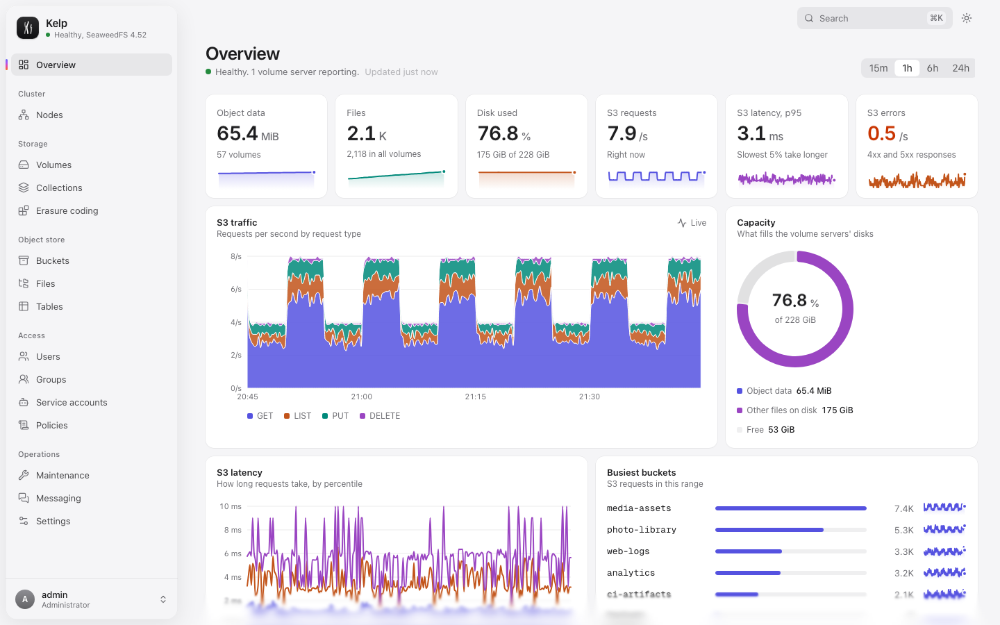
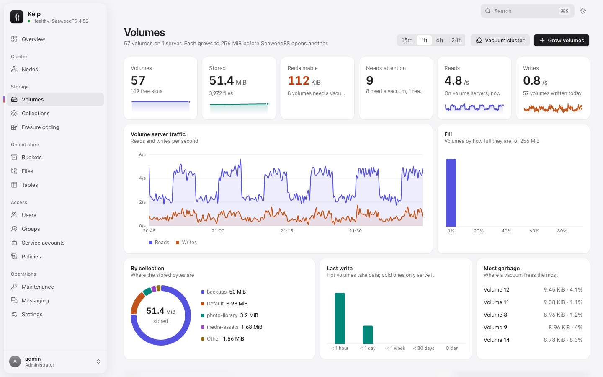
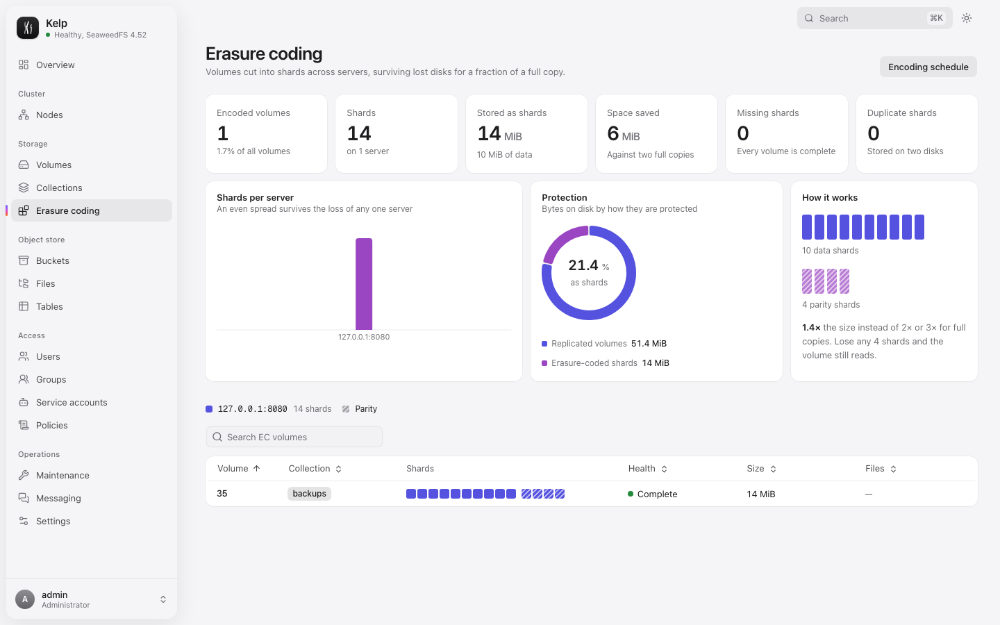
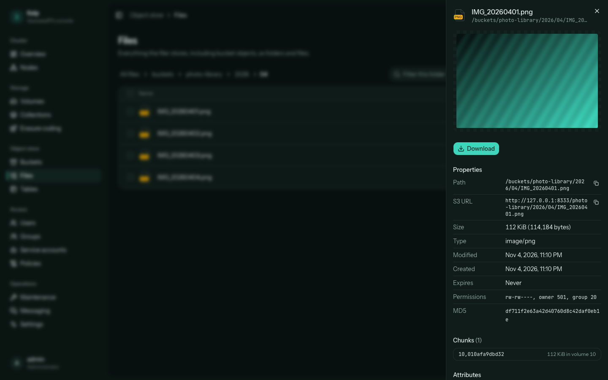
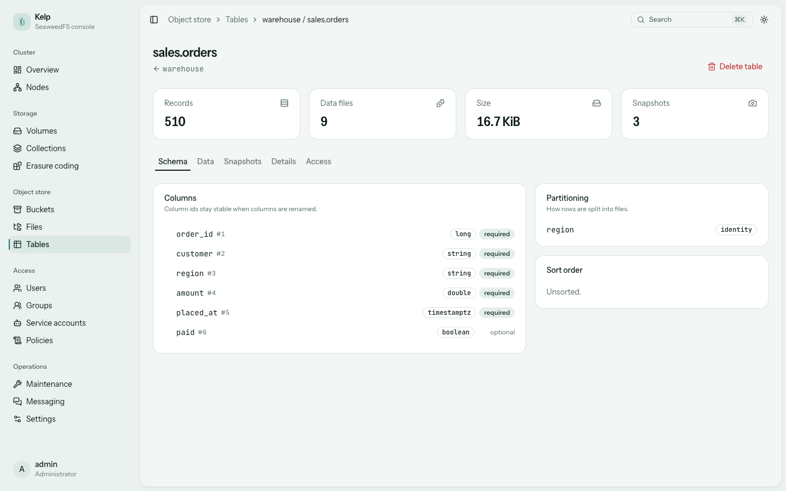
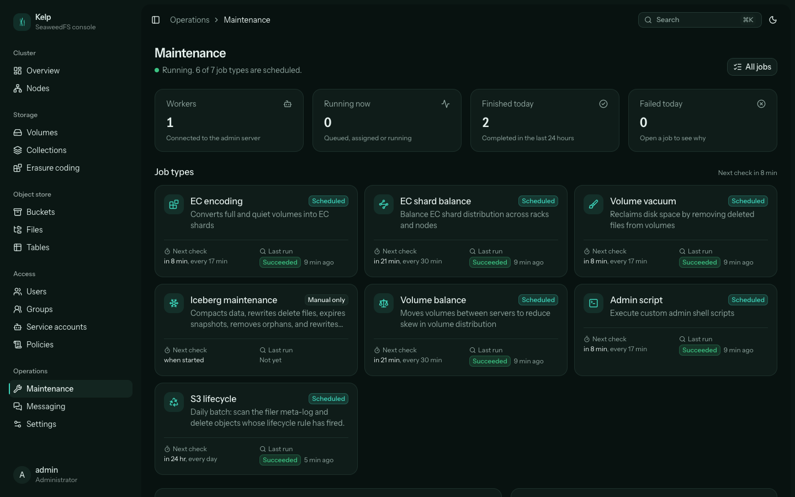
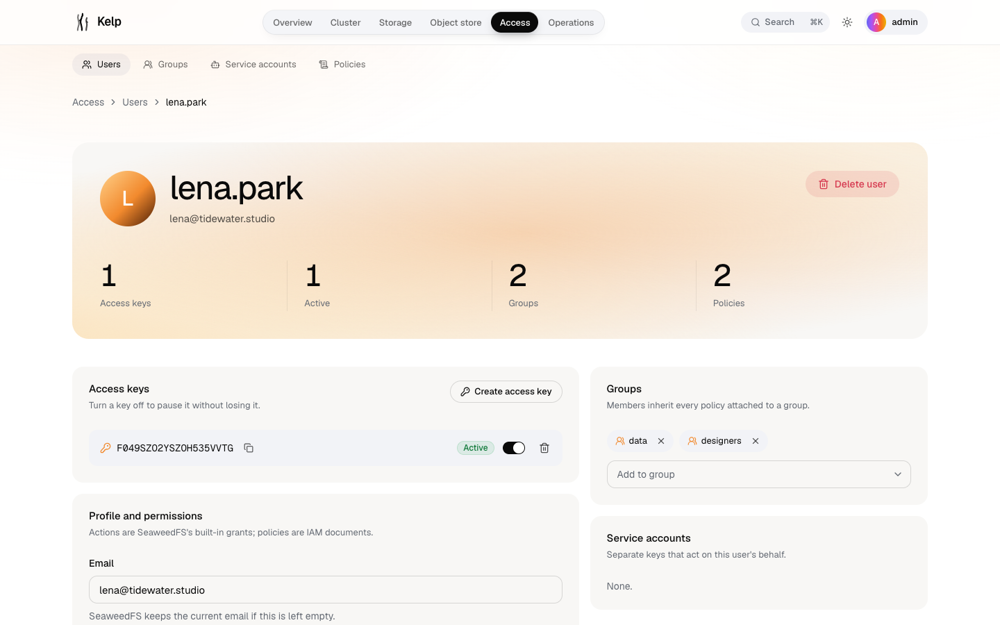

<p align="center">
  
</p>

<h1 align="center">Kelp</h1>

<p align="center">
  A calm, complete console for <a href="https://github.com/seaweedfs/seaweedfs">SeaweedFS</a>.<br>
  Shipped with SeaweedFS as one Docker Compose stack, so both deploy and upgrade together.
</p>

<p align="center">
  <a href="https://github.com/vvisionnn/kelp/actions/workflows/ci.yml"></a>
  <a href="https://github.com/vvisionnn/kelp/releases/latest"></a>
  <a href="LICENSE"></a>
</p>



Kelp manages a SeaweedFS cluster without changing it. It drives the native admin API, the master, the filer and their gRPC services, and adds what the built-in pages lack: an Apple-grade dashboard design of its own (see [DESIGN.md](DESIGN.md)), sign-in with read-only accounts, safer destructive actions, skeleton loading, light and dark themes, and pages that explain what they show.

## What you can do

| Area             | In Kelp                                                                                                                                                                                                                                                                                                                             |
| ---------------- | ----------------------------------------------------------------------------------------------------------------------------------------------------------------------------------------------------------------------------------------------------------------------------------------------------------------------------------- |
| **Cluster**      | Health at a glance, disk capacity, storage tiers, version drift. Topology by data center and rack. Masters (with the Raft leader), volume servers, filers, S3 gateways, message brokers and FUSE mounts.                                                                                                                            |
| **Storage**      | Every volume with size, files, garbage and replica health. Vacuum a volume or the whole cluster, freeze and unfreeze volumes, grow volumes into a collection, delete collections. An animated shard map for every erasure-coded volume, with rebuild guidance when shards go missing.                                               |
| **Object store** | Create buckets with quota, owner, versioning and object lock. Lifecycle rules, bucket policies with templates, and a file browser for the whole filer: streaming uploads with drag and drop, folders, rename, bulk delete, previews for images, video, audio, PDF, text and JSON. Version history for objects in versioned buckets. |
| **Tables**       | S3 Tables and Iceberg: table buckets, namespaces and tables, tags and policies, and a table view with schema, partitioning, snapshots and a live row preview read from Parquet.                                                                                                                                                     |
| **Access**       | Users, access keys, groups, service accounts and IAM policies. New secrets show once and are never sent again: Kelp strips every secret the admin API returns. Policies are validated by SeaweedFS as you type.                                                                                                                     |
| **Maintenance**  | The admin's job system in plain language: every job type with a settings form generated from SeaweedFS's own field descriptions, "check for work" and "run now", run history, job timelines and a live activity feed.                                                                                                               |
| **Messaging**    | Brokers and the elected leader, topics with partition rings, retention and purging.                                                                                                                                                                                                                                                 |
| **Settings**     | Theme (system, light or dark), cluster configuration, and how Kelp is connected.                                                                                                                                                                                                                                                    |

<table>
  <tr>
    <td></td>
    <td></td>
  </tr>
  <tr>
    <td></td>
    <td></td>
  </tr>
  <tr>
    <td></td>
    <td></td>
  </tr>
</table>

## Run it

You need Docker with Compose.

```sh
curl -LO https://github.com/vvisionnn/kelp/releases/latest/download/docker-compose.yml
curl -L -o .env https://github.com/vvisionnn/kelp/releases/latest/download/kelp.env.example
# Fill in the passwords and keys in .env, then:
docker compose up -d
```

Kelp is on port 3000 and the S3 API on port 8333. Add `--profile messaging` to also run a message broker.

The stack runs four SeaweedFS services and Kelp:

```
                     ┌──────────── control network (internal, no internet) ────────────┐
 browser ──► kelp ───┼──► admin (native admin API, no login of its own)                │
   :3000      │      │      ▲                                                          │
              │      │      └── worker (vacuum, erasure coding, balancing, lifecycle)  │
              └──────┼──► seaweedfs (master, volume, filer, S3) ◄── broker (optional)   │
 S3 clients ─────────┼──────►  :8333                                                   │
                     └─────────────────────────────────────────────────────────────────┘
```

The native admin API has no authentication in this setup, so it never gets a published port. Kelp is the only way in, with its own sign-in.

### On Coolify

Create a **Docker Compose** resource from this repository (or paste the release's `docker-compose.yml`), set the variables below in Coolify's environment tab, and assign domains to the `kelp` service (port 3000) and the `seaweedfs` service (port 8333). Pin `KELP_VERSION` to a release, or leave it at `latest` and let Coolify pull updates.

### Configuration

| Variable                                   | Required | What it does                                                                     |
| ------------------------------------------ | -------- | -------------------------------------------------------------------------------- |
| `KELP_ADMIN_PASSWORD`                      | yes      | Password for the administrator account (`KELP_ADMIN_USER`, default `admin`).     |
| `KELP_SESSION_SECRET`                      | yes      | Signs session cookies. Use a long random value, e.g. `openssl rand -hex 32`.     |
| `S3_ACCESS_KEY`, `S3_SECRET_KEY`           | yes      | Bootstrap S3 admin identity. Create scoped users and keys in Kelp afterwards.    |
| `SEAWEEDFS_WORKER_KEY`                     | yes      | Shared secret between the native admin and the maintenance worker.               |
| `KELP_VIEWER_USER`, `KELP_VIEWER_PASSWORD` | no       | An optional read-only account.                                                   |
| `KELP_S3_ENDPOINT`                         | no       | Public S3 URL, used for copyable object URLs.                                    |
| `KELP_SESSION_TTL_HOURS`                   | no       | How long a sign-in lasts (default 12).                                           |
| `KELP_METRICS_URLS`                        | no       | SeaweedFS Prometheus endpoints for the live charts. The compose file sets them.  |
| `KELP_VERSION`, `SEAWEEDFS_VERSION`        | no       | Image versions. Each Kelp release pins the SeaweedFS version it was tested with. |
| `KELP_PORT`, `S3_PORT`                     | no       | Published ports (defaults 3000 and 8333).                                        |

Kelp itself also reads `KELP_ADMIN_URL`, `KELP_MASTER_URL`, `KELP_FILER_URL` (and optional `KELP_MASTER_GRPC`, `KELP_FILER_GRPC`) to find SeaweedFS. The compose file sets them for you.

### Upgrading

Kelp and SeaweedFS move together. CI tests every Kelp change against the exact `weed` release pinned in `mise.toml`, and a test fails if `docker-compose.yml` names a different version. To upgrade, pull the newer release's compose file (or bump `KELP_VERSION` and `SEAWEEDFS_VERSION` together) and run `docker compose up -d`.

## Security model

- **Sign-in.** Sessions are HMAC-signed, HttpOnly cookies, and repeated failed sign-ins are throttled. The viewer role can read everything and change nothing; the server enforces this, not only the UI.
- **CSRF.** Every write needs an `x-kelp-csrf` header, which browsers will not send cross-site without a preflight.
- **Secrets.** Kelp never returns stored S3 secrets. A new key's secret appears exactly once, in the response that created it.
- **Isolation.** The admin API and worker sit on an internal network with no published ports.
- **Downloads.** Files a browser could execute are served sandboxed, so they cannot reach your session.

## Develop

[mise](https://mise.jdx.dev) installs the exact Bun, Node, `weed`, actionlint and shellcheck versions:

```sh
mise install && bun install
bun run stack      # SeaweedFS from the native weed binary: master, volume, filer, S3, admin, worker
bun run dev        # Kelp API on :3001 and Vite on :5173, signed in as admin / kelp
bun run seed       # optional: a realistic studio's buckets, users, tables and topics
```

`bun run review` does all of that in one step on a fresh data folder, with a message broker. It serves a production build on port 3000 (admin `review-admin`, viewer `review-viewer`).

| Command                 | What it checks                                                                                                         |
| ----------------------- | ---------------------------------------------------------------------------------------------------------------------- |
| `bun run check`         | Biome lint and formatting, TypeScript 7 types, unit tests with a 95% per-file coverage gate, and the production build. |
| `bun run e2e`           | Playwright against a real SeaweedFS started from the `weed` binary on shifted ports, so it can run beside a dev stack. |
| `bun run compose:smoke` | Builds the image, boots `docker-compose.yml`, and checks sign-in, every SeaweedFS component, the worker and S3.        |

The code is organized as follows:

```
server/         Hono gateway: auth, sessions, one router per area, mappers for SeaweedFS JSON
  upstream/     HTTP and gRPC clients (protos vendored from SeaweedFS in proto/)
  iceberg/      Avro manifest reader for Iceberg tables
shared/         Types shared by the server and the web app
src/            React 19, TanStack Router and Query, Tailwind 4, Base UI, motion
  routes/       File-based routes, one folder per area
  components/   kelp/ is Kelp's own; ui/, reui/ and react-bits/ are vendored registries
fixtures/       Real responses captured from SeaweedFS 4.52, used by the unit tests
e2e/            Playwright specs
DESIGN.md       Kelp's design system: color, type, components, layout and motion
scripts/        Local stack, seed data, review environment, releases
```

### Releasing

```sh
bun run release minor   # or major, patch, or an explicit x.y.z
```

This runs every check, updates `CHANGELOG.md` with git-cliff, and tags. The tag triggers CI again, then publishes a multi-arch image to `ghcr.io/vvisionnn/kelp` and a GitHub release with a version-pinned `docker-compose.yml`.

## Credits

Kelp is MIT licensed. It builds on [SeaweedFS](https://github.com/seaweedfs/seaweedfs) (its gRPC protos are vendored under Apache 2.0), components from [shadcn/ui](https://ui.shadcn.com), [ReUI](https://reui.io) and [React Bits](https://reactbits.dev). See [NOTICE.md](NOTICE.md) for details.
